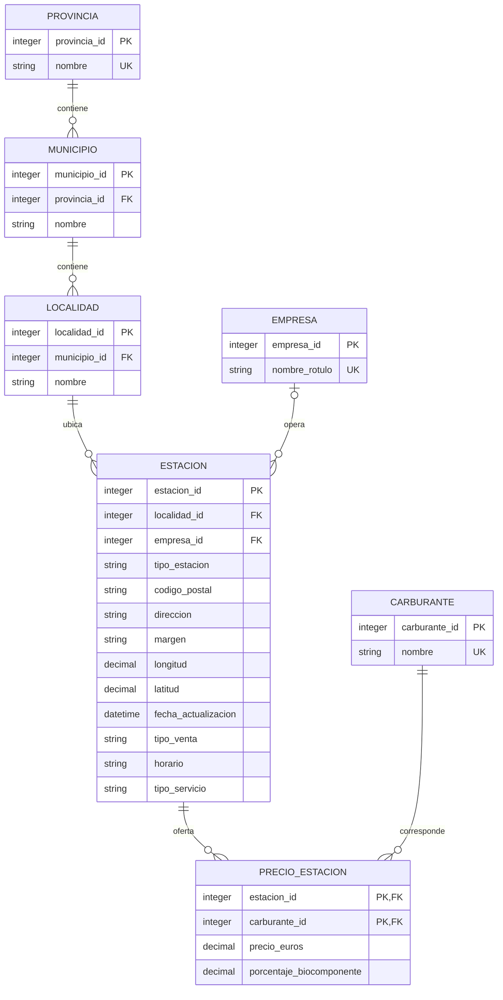

# Modelo relacional de estaciones de servicio

## Decisiones y correspondencia con los ficheros

- `ESTACION.tipo_estacion` distingue `TERRESTRE` de `MARITIMA`. Esto permite contar por separado las estaciones de cada empresa.
- Provincia, municipio y localidad se separan para evitar repetir la jerarquía territorial y para facilitar las consultas por provincia o comunidad autónoma. La comunidad autónoma no está presente en los Excel; si se necesitara consultar directamente por ella, se puede añadir una tabla `COMUNIDAD_AUTONOMA` sobre `PROVINCIA` o resolver Madrid mediante su provincia.
- `EMPRESA.nombre_rotulo` procede de la columna `Rótulo`, que es la única identificación del operador incluida en los datos. La relación es opcional porque 5 de los 141 registros marítimos no informan este campo.
- `margen` procede de `Margen` y solo se aplica a estaciones terrestres (`D`, `I` o `N`); en las marítimas queda nulo.
- `fecha_actualizacion` procede de `Toma de datos` en estaciones terrestres. Como el fichero marítimo no ofrece una fecha por poste, se utiliza la fecha de generación indicada en la cabecera del archivo.
- `tipo_venta`, `horario` y `tipo_servicio` conservan respectivamente `Tipo venta`, `Horario` y `Tipo servicio`. Este último queda nulo en estaciones marítimas.
- Cada columna cuyo nombre comienza por `Precio` se transforma en un registro de `CARBURANTE` y otro de `PRECIO_ESTACION` cuando contiene un valor. Así se pueden incorporar carburantes nuevos sin alterar el esquema.
- `porcentaje_biocomponente` conserva `% bioalcohol` para bioetanol y `% éster metílico` para biodiésel cuando el origen proporcione esos datos.
- Latitud y longitud deben cargarse como números decimales, reemplazando la coma decimal de los Excel. Estos campos permiten realizar búsquedas por proximidad y calcular distancias mediante funciones geográficas del gestor de base de datos o la fórmula de Haversine.

## Restricciones lógicas recomendadas

- `MUNICIPIO`: valor único para `(provincia_id, nombre)`.
- `LOCALIDAD`: valor único para `(municipio_id, nombre)`.
- `ESTACION`: valor único para `(tipo_estacion, localidad_id, codigo_postal, direccion)`.
- `PRECIO_ESTACION`: clave primaria compuesta `(estacion_id, carburante_id)` y `precio_euros > 0`.
- `tipo_estacion` limitado a `TERRESTRE` o `MARITIMA`; `margen` limitado a `D`, `I`, `N` o nulo.
- `latitud` entre -90 y 90 y `longitud` entre -180 y 180.
